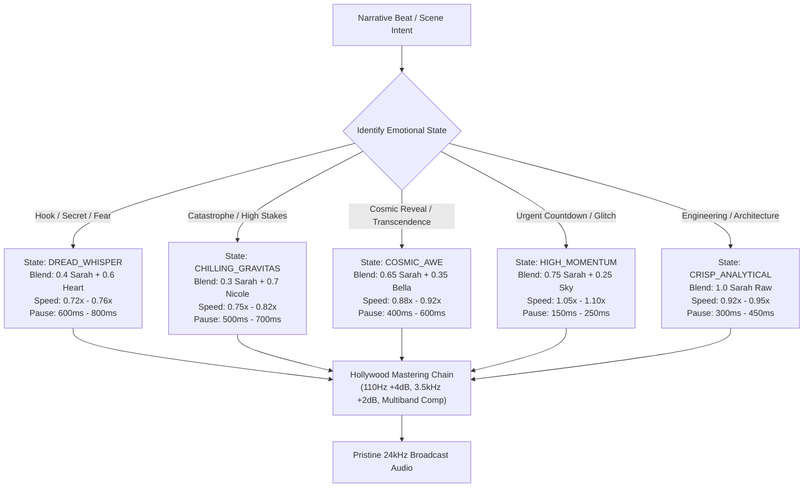

# CALLIOPE DECISION TREE — Acoustic & Emotion Directing Logic

> **STATUS**: Active Acoustic Tree  
> **ENGINE**: `scripts/tts_director.py` (Kokoro-82M Local Neural Engine + FFmpeg Mastering)  
> **BASE VOICE**: `af_sarah` (US Female, Articulate Modern Narrator)

---

## 1. The Acoustic Decision Tree



---

## 2. Emotional State Parameter Matrix

| State Name | SSML Tag | Blend Ratio | Speed Range | Pre/Post Pause | Target Perception |
| :--- | :--- | :--- | :--- | :--- | :--- |
| **`DREAD_WHISPER`** | `<express-as style="whispering">` | `0.40 Sarah + 0.60 Heart` | `0.72x – 0.76x` | `600ms – 800ms` | Intimate, terrified, breathless confession. |
| **`CHILLING_GRAVITAS`** | `<express-as style="dramatic">` | `0.30 Sarah + 0.70 Nicole` | `0.75x – 0.82x` | `500ms – 700ms` | Dark mathematical certainty, cold doom. |
| **`COSMIC_AWE`** | `<express-as style="awe">` | `0.65 Sarah + 0.35 Bella` | `0.88x – 0.92x` | `400ms – 600ms` | Breathtaking scale, transcendence, wonder. |
| **`HIGH_MOMENTUM`** | `<express-as style="urgent">` | `0.75 Sarah + 0.25 Sky` | `1.05x – 1.12x` | `150ms – 250ms` | Ticking clock, system panic, cascading failure. |
| **`CRISP_ANALYTICAL`** | `<express-as style="narration-professional">` | `1.00 Sarah (pure)` | `0.92x – 0.95x` | `300ms – 450ms` | David Fincher precision, surgical clarity. |

---

## 3. The Punctuation Stress Rules

In Kokoro-82M, punctuation dictates the neural phoneme duration predictor:
1. **Ellipses (`...`)**: Forces a natural deceleration and pitch drop before silence. Use before punchlines.
2. **Em-Dash (`—`)**: Triggers an abrupt mental interruption.
3. **Period (`.`)**: Generates full downward cadence. Never string long sentences without periods.
4. **Commas (`,`)**: Micro-breath pauses ($100\text{ms}$).

---

## 4. Hollywood Mastering Preset

Every raw neural render is processed through the custom FFmpeg acoustic filter:
```bash
ffmpeg -y -i raw.wav \
  -af "bass=g=4:f=110,equalizer=f=3500:t=q:w=1:g=2,acompressor=threshold=-18dB:ratio=4:attack=5:release=50,volume=1.2" \
  -b:a 192k master.mp3
```
- **`bass=g=4:f=110`**: Adds chest proximity resonance so the voice sounds like it is inside high-end cinema monitors.
- **`equalizer=f=3500:t=q:w=1:g=2`**: Brings speech intelligibility and crisp consonant presence forward.
- **`acompressor`**: Clamps peaks and elevates delicate whispered details without clipping.
